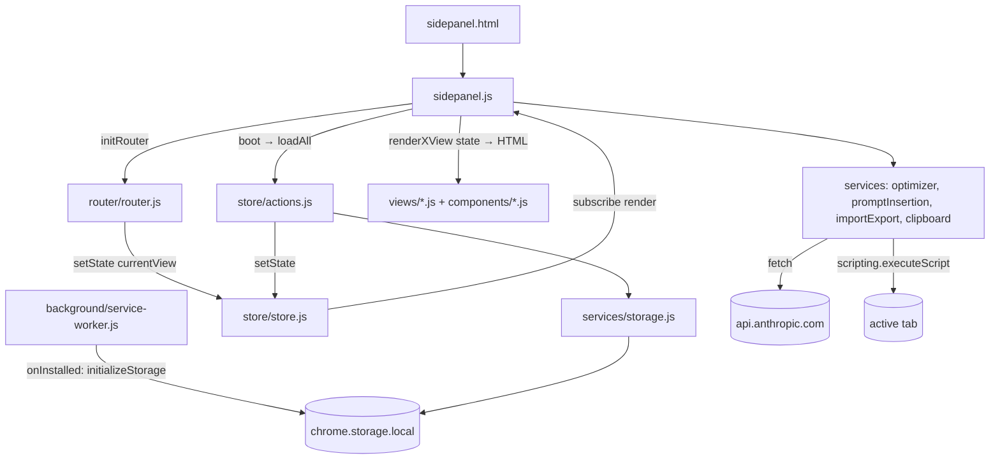

# 🗺️ Prompt Whisperer — Workspace Map

> [!NOTE]
> **What this is**: where things live and how they connect in this MV3 side-panel extension. It has no build step and no framework; the browser loads the ES modules directly.

Files: see the **Key Files** table in `CLAUDE.md`. Architecture rules and gotchas: `CLAUDE.md` → *Architecture notes*. Features and install: `README.md`. Full spec and deferred work: `Prompt Whisperer Features.md`.

> [!WARNING]
> The repo is **public**. The user's prompt library and Anthropic API key live in `chrome.storage.local` and never in the repo. Exported backups (`prompt-whisperer-backup-*.json`, `prompt-assistant-backup-*.json`) are gitignored. Keep it that way.

## Anatomy



| Layer | Where | Key symbols |
|---|---|---|
| Entry / service worker | `background/service-worker.js` | `chrome.sidePanel.setPanelBehavior` (must stay top-level sync), `onInstalled` → `initializeStorage` |
| Panel shell | `sidepanel.html` | mount points `#app-header`, `#app-nav`, `#app-view`, `#app-footer`, `#app-modal`, `#app-toast` |
| App controller | `sidepanel.js` | `boot`, `render`, `renderViewHtml`, `renderPreservingFocus`, form-draft helpers (`syncDraftFromForm`, `resetFormDraft`, `populateFormDraftFromPrompt`), `runOptimize`, `doInsert`, `doCopy`, `debouncedSearch` |
| Event delegation | `sidepanel.js` | one `click`/`change`/`input`/`submit` listener on `#app`, dispatching on `data-action`/`data-field`; `keydown` on `document` for shortcuts (Ctrl/⌘+N new, Ctrl/⌘+F and `/` search, Ctrl/⌘+S save, Esc close modal) |
| Router | `router/router.js` | `VALID_VIEWS`, `parseHash`, `applyHash` (dirty-form confirm), `initRouter`, `navigate` |
| State | `store/store.js` | `getState`, `setState`, `setStateSilent`, `subscribe`; the initial `state` literal documents every transient UI flag |
| Mutations | `store/actions.js` | `loadAll`, `createPrompt`, `editPrompt`, `deletePromptById`, `duplicatePrompt`, `toggleFavorite`, category/tag CRUD, `updateSettings`, `resetToSampleData`, `mergeImport`, `toggle*Expanded`, `showToast`/`openModal` |
| Views | `views/*.js` | `renderLibraryView` (`computeTagCounts`, `filterPrompts`), `renderPromptForm` (shared by `renderCreateView`/`renderEditView`), `renderOptimizeView`, `renderSearchView`, `renderImportExportView`, `renderSettingsView` |
| Components | `components/*.js` | `renderHeader`, `renderNavigation` (`TABS`), `renderFooter`, `renderModal` (all modal kinds, keyed on `state.activeModal`), `renderToast`, `renderPromptCard`, `renderTagChip`, `icon` |
| Utilities | `utils/*.js` | `escapeHtml`, `delegate`, `debounce`, `qs`/`qsa`; `newId`, `slugify`; `nowIso`, `formatDate`; `validatePrompt`, `validateCategoryName`, `validateTagName`, `normalizeTag` |

Routes (`#/<view>[/<param>]`): `library`, `create`, `edit/:id`, `optimize`, `import-export`, `search`, `settings`. An unknown hash falls back to `library`.

`content/content-script.js` is a placeholder only. It isn't declared in the manifest and isn't loaded. Insertion goes through `insertIntoActiveTab` → `insertTextIntoActiveElement` via `executeScript` func/args.

## Data stores & persistence

| Piece | Symbol(s) | Note |
|---|---|---|
| Persistent root | `services/storage.js` `KEYS`, `getAll` | Four top-level keys in `chrome.storage.local`. `getAll` seeds via `initializeStorage` if `schemaVersion` is missing. |
| Migration | `SCHEMA_VERSION`, `migrate` | Stub only: it stamps the version. Add schema bumps here. |
| Write pattern | `savePrompt`, `updatePrompt`, `deleteCategory`, … | Read-modify-write of the whole array on every change; actions then `setState` with the returned array. |
| Tags | `storage.js` `renameTag`/`deleteTag` | Tags are strings inside `prompt.tags`, with no collection of their own. Rename and delete are bulk rewrites across prompts. |
| Category rename / delete | `storage.js` `renameCategory`, `deleteCategory(id, { reassignToId })` | Both write `categories` and `prompts` together to keep the denormalised `categoryName` in step. Delete reassigns orphaned prompts. |
| Name repair on load | `syncCategoryNames` (called by `actions.loadAll`) | Fixes any prompt whose `categoryName` differs from its category. It writes only if something changed. |
| Seed / defaults | `data/seed-data.js` `seedCategories`, `seedPrompts`, `defaultSettings` | Used on first install and by `resetToSampleData`. |
| Import / export | `services/importExport.js` `buildExport`, `parseImportFile`, `buildImportPreview`; `actions.mergeImport` | Export embeds `schemaVersion` and `application: 'Prompt Whisperer'`. Duplicate strategy is Skip/Replace/Keep Both. |
| Transient UI state | `store/store.js` initial `state` | In memory only and resets on every panel open: view, filters, expanded flags, drafts, modal, toast. |

## Data schema

```jsonc
// chrome.storage.local
{
  "schemaVersion": 1,
  "categories": [ { "id": "coding", "name": "Coding", "createdAt": "ISO" } ],   // N records
  "prompts": [ {
    "id": "uuid", "title": "…", "categoryId": "coding",
    "categoryName": "Coding",          // denormalised copy shown by renderPromptCard; set by createPrompt/editPrompt/renameCategory/deleteCategory, repaired by syncCategoryNames
    "tags": ["debug", "python"],       // plain strings
    "content": "…", "notes": "",
    "isFavorite": false, "createdAt": "ISO", "updatedAt": "ISO", "version": 1
  } ],                                 // N records
  "settings": {
    "appearance": "light",             // light | dark | system
    "defaultStartupView": "library",
    "promptClickBehavior": "open",
    "importExport": { "includeNotes": true, "includeFavorites": true, "prettyPrintJson": true },
    "optimization": {
      "provider": "mock",              // mock | anthropic (PROVIDERS in services/optimizer.js)
      "model": "", "apiEndpoint": "",
      "apiKey": "",                    // plain text, user-entered in Settings
      "availableModels": [], "modelsFetchedAt": null,
      "defaultGoal": "general"         // OPTIMIZATION_GOALS
    }
  }
}
```

## External pieces (outside the repo)

- **Live data**: the Chrome profile's `Local Extension Settings\<extension-id>\` LevelDB folder. Removing the unpacked extension deletes it. See the `extension-storage-data-loss` memory for recovery.
- **Anthropic API**: `services/optimizer.js` `anthropicProvider` (`POST /v1/messages`) and `fetchAnthropicModels` (`GET /v1/models`), called directly from the panel. The key is read from `settings.optimization.apiKey`.
- **Chrome Web Store**: `webstore/privacy-policy.html` is the listing's privacy page. It isn't loaded by the extension. `store/` is app state only.
- **Design references (repo root)**: `Prompt Whisperer Features.md` (spec) and the concept/UI `.png` mockups. None of them are loaded by the extension.
- **Tests**: none. Verification is manual in Chrome.

## Git

Remote `origin` → `github.com/vtak007/Prompt-Whisperer` (public). Default branch `main`. Work happens on `feature/*` branches that are merged back with a merge commit, per the global `CLAUDE.md` gates.

## Working notes

Run: `chrome://extensions` → Load unpacked → this folder. After edits, use the ↻ reload button. **Never** remove and re-add the extension.

| I want to… | Go to |
|---|---|
| Add a new screen | Add to `VALID_VIEWS` (router), add a `renderXView` in `views/`, wire it in `renderViewHtml` (`sidepanel.js`), add a tab in `TABS` (`components/Navigation.js`) |
| Add a button / action | Emit `data-action="…"` in the view, handle it in the `#app` `click` listener in `sidepanel.js`, put the mutation in `store/actions.js` |
| Add a modal | Add a case in `renderModal` (`components/Modal.js`), open it with `actions.openModal`, handle its form in the `submit` listener |
| Change what's persisted | `services/storage.js` (+ bump `SCHEMA_VERSION`, implement `migrate`), plus `defaultSettings` in `data/seed-data.js` |
| Add an AI provider | `PROVIDERS` + a new provider fn in `services/optimizer.js`; provider options in `renderSettingsView` |
| Change insertion behaviour | `insertTextIntoActiveElement` in `services/promptInsertion.js` |
| Add an icon | `ICONS` in `components/icons.js` |
| Restyle | `sidepanel.css` (light palette only; dark is derived, so check both) |
